# Ambermoon for Atari

> A technical approach to the question:  
> **What might Ambermoon have felt like on the Atari ST and Falcon?**

*An unofficial fan project. It is not affiliated with Thalion or with the current rights holders.*

<p align="center">
  <a href="#screenshots">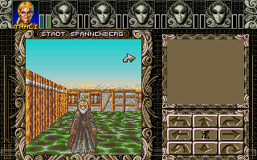</a>
  <a href="#screenshots">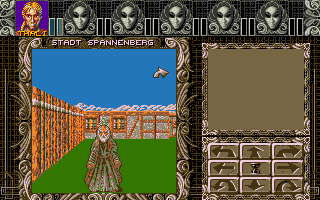</a>
  <a href="#screenshots">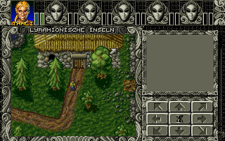</a>
  <a href="#screenshots">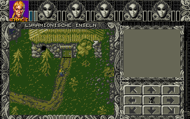</a>
  <br>
  <sub>Falcon030 and ST/STE at the same places. More under <a href="#screenshots">Screenshots</a>.</sub>
</p>

To me, *Ambermoon* is more than one of the great role-playing games of the 16-bit era. The game has stayed with me for many years and helped shape my enthusiasm for that era, its technology and the particular way games were made back then.

The idea of bringing *Ambermoon* to the Atari has been with me for a long time. I knew the existing work around the game well, and this idea was one of the reasons I took up 68000 assembly and the hardware of the Atari ST again in 2025.

During that time, AI developed far enough to make the port possible within a manageable time.

That is how this project began.

## Features

**Faithful to the original**
- **Thalion's original source code, assembled unchanged:** 38 of its 39 files. Only the library layer, which was never released, is written anew. Game flow, rules and layout are Thalion's, not a remake.
- **The original game files, read at run time:** containers, encryption and compression are unpacked by the game itself; nothing is converted in advance.
- **50 Hz, as on the Amiga:** on an RGB monitor the game runs in PAL, because Thalion's game time and animations count frames.

**Atari Falcon030**
- **32 colours per screen area**, as the Amiga's Copper palettes give them.
- **The original music, played by Thalion's own player routine**, mixed by the DSP; optionally by the CPU, or Big Alec's YM version instead.
- **Fantasy intro, intro and extro**, with music.
- **RGB and VGA monitors.**

**Atari ST/STE**
- **16 colours**, reduced from the original's 32, with hand-tuned palettes.
- **Uses what the machine has:** the STE's 4-bit palette and the blitter where present; `PLAIN_ST=YES` makes an STE behave like a plain ST.
- **Big Alec's YM music**, the fantasy intro and the intro with its start menu.
- **A palette check page:** every ST build writes `build/st_palettes/index.html` from your own game files. For each palette it shows Thalion's colours next to the STE and ST results of each reduction method; choose a method per palette and download the resulting `tools/st_palettes.txt` for the next build.

**On both machines**
- **One folder for the Falcon and the ST:** one `AMBER.TOS` detects the machine.
- **Shared save games:** save on the Falcon, go on playing on the ST, and back.
- **One settings file `AMBER.INF`** (music, ST mode), and `MUSIK_YM.INF` to choose which YM piece plays where.
- **A clean way out after a crash:** back to the desktop with its colours, mouse and sound settings.

**For those who build it themselves**
- **The build checks every place it takes from the original files:** another version of the game stops it with a message instead of giving a broken program.
- **Paths in `build.cfg`** or a folder next to the repository; no environment variables needed.
- **Developer documentation in English**, with a guide to the Atari layer.

> **TODO:** save games exchanged with the Amiga version and the English game data are not tested yet; they are listed here once they are.

---

## Screenshots

The same moments on both machines, Falcon030 on the left, ST/STE on the right. The Falcon030 shows Thalion's 32 colours per screen area; the ST/STE shows 16 per screen area, reduced live through the palette. The pictures come from the emulator Hatari, at the native resolution, with the German game files 1.20.

**The fantasy intro: the fairy and the Fantasy logo**

<p>
  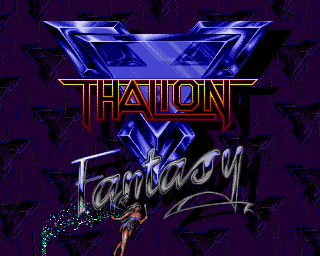
  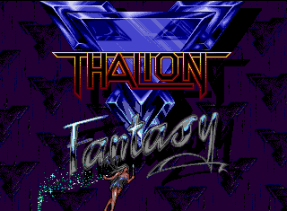
</p>

**The intro: the meteor falls on Twinlake**

<p>
  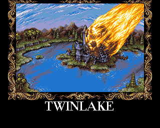
  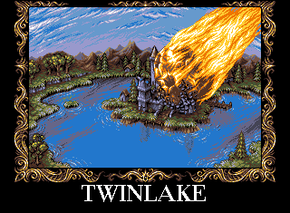
</p>

**Grandfather's house (2D)**

<p>
  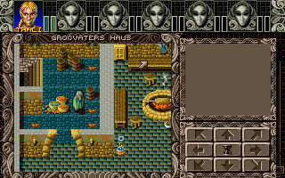
  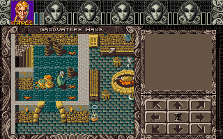
</p>

**The Lyramion islands (2D)**

<p>
  
  
</p>

**Grandfather's cellar (3D)**

<p>
  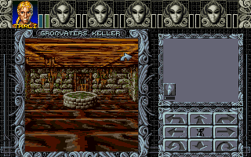
  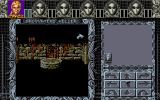
</p>

**The city of Spannenberg (3D)**

<p>
  
  
</p>

**The house of the trainers (2D)**

<p>
  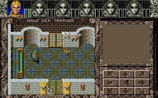
  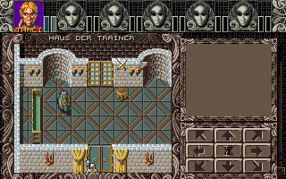
</p>

## Quickstart

> **TODO:** Parts of this section will only be settled shortly before release.

### Requirements

**To play:**

- Atari Falcon030 with at least 4 MB RAM, or (tested on real Falcon 030/14MB and Hatari 4MB)
- Atari ST/STE with 4 MB RAM (target platform: 8 MHz 68000)
- Hard disk required

**What you need to obtain yourself** (none of it is in this repository):

- the original *Ambermoon* game files, i.e. the `Amberfiles` folder of an existing Amiga version (tested: German version 1.20; [ ] English version TODO)
- Thalion's historical source code from [Jurie Horneman's repository](https://github.com/jhorneman/ambermoon); it is only read during the build
- optionally Big Alec's YM music, the file `big_alec/ambermon.snd` from the [SNDH archive](https://sndh.atari.org/?ID=5364) (see below)

**To build:**

- Linux (tested so far; [ ] macOS and Windows/WSL TODO)
- `vasmm68k_mot` and `vlink` (68000 assembler and linker)
- `a56` (DSP56001 assembler, for the Falcon's music mixer)
- Python 3
- an `objdump` for m68k

### Building

```bash
export AMBER_DATEN=/path/to/ambermoon        # the directory that contains Amberfiles/
export AMBER_URCODE=/path/to/ambermoon/src   # Thalion's source code
export AMBER_YMSNDH=/path/to/ambermon.snd    # optional: Big Alec's YM music
sh tools/build_all.sh       # both machines; build_falcon.sh or build_st.sh for one
```

Instead of the `export` lines, the paths can go into a file `build.cfg` (template `build.cfg.example`), or the three things go into a folder `ambermoon_gamedata/` next to the repository, under the names in the template; `python3 tools/paths.py` shows what the build finds.

The build reads the game files and Thalion's source code from there, assembles everything and puts the result into `ATARI/`, one folder for the Falcon and the ST. It shows one line per step; everything else goes into `build/build.log` (`VERBOSE=1` shows all of it). If something is missing or fails, it names the step and shows the last lines of the log. Step by step, for Linux, macOS and Windows (WSL): [docs/developer/building.md](docs/developer/building.md).

### Installation

Copy the contents of `ATARI/` to the Atari's hard disk:

```text
AMBER.TOS        the start program, for Falcon and ST/STE
AMBFILES\        game files, programs and saved games, shared by both
```

The same folder runs on both machines, and a saved game from one continues on the other.

### Starting

Run `AMBER.TOS` on either machine; it finds out which one it runs on. It leads through the fantasy intro, the intro with its start menu, the game and, once the game is finished, the extro.

### Choosing the music

The music is chosen in the file `AMBFILES\AMBER.INF`, with a line `MUSIC=`:

```text
MUSIC=DSP   original music, mixed by the DSP (default, also without the file)
MUSIC=CPU   original music, mixed by the processor
MUSIC=OFF   no music
MUSIC=YM    Big Alec's YM music (needs ambermon.snd)
```

The ST always plays the YM music; there only `MUSIC=OFF` counts.

### Known limitations

State: 2026-10-29. This list is updated before the release.

- **ST, 3D on 8 MHz is slow.** Thalion's 3D code runs unchanged; a real gain would mean replacing parts of it with our own. That would break the first principle of this project (see "Goals of the project") and is deliberately not decided yet.
- **YM music: 18 pieces instead of 32.** Big Alec's YM version covers 18 of Thalion's pieces; with YM, the other places stay silent, intro and extro too.
- **ST: no extro yet**, and the intro's start menu does not yet highlight the entry under the pointer.
- **ST: the "drugged" effect** shows no colours; only the mouse pointer shakes.
- **Falcon: not at full speed yet.** The 2D maps are meant to need at most 4 screen refreshes (VBLs) per picture drawn; scrolling text is slow; moving the mouse costs frames in 3D.
- **Not tested yet:** a whole game through to the end; parts of combat (spells, flight, the death of a party member); the English game data; the smallest memory it runs with (4 MB on a real Falcon).

### Possible improvements

Ideas, nothing of it is promised or measured:

- **YM pieces of our own** for the 14 that are missing, as SNDH files in one shared folder, perhaps made by a converter from Sonic Arranger; and loading `ambermon.snd` directly, without a build step.
- **STE: DMA sound instead of YM**, so the ST plays Thalion's original music with the Amiga samples. It costs much processor time; probably too much for 3D on 8 MHz.
- **ST: faster 3D**, either by the decision above or by more precomputation in our layer, which leaves Thalion's code alone.
- **Faster machines:** Mega STE at 16 MHz with cache, TT030, a Falcon with an accelerator card. Not tested on purpose; they may gain by themselves.
- **Save games exchanged with the Amiga version:** the format is Thalion's, unchanged; it only needs testing.

---

## Motivation

A key starting point for me was the historical reference to an Atari ST version of *Ambermoon*.

Thalion referred to an ST/Falcon version on the box and in material from the time. This at least suggests that they believed *Ambermoon* could be brought to Atari hardware and made playable on the ST despite its technical limits – in particular with graphics reduced to 16 colours.

That idea fascinated me.

What could *Ambermoon* have looked like on an Atari ST?

And perhaps more importantly: **What would it have felt like?**

Not as a modern reinterpretation and not as a loose remake, but as close as possible to the game Thalion actually made – with the same data, large parts of the same code, and the limits of real Atari hardware.

The project is therefore also a technical experiment: to find out how far the existing architecture of *Ambermoon* really carries over to the ST and Falcon.

---

## Historical background

*Ambermoon* was developed by Thalion, a studio whose history is closely tied to the Atari ST.

Its predecessor *Amberstar* was released on the Atari. *Ambermoon*, too, shows traces of an Atari version that was at least planned – including references on the box and in texts of the time.

It was never released, though. *Ambermoon* came out in 1993 for the Amiga only, shortly before Thalion's story came to an end.

More than three decades later, I found it especially appealing to ask how far this unrealised plan can be retraced with the sources that survive today.

---

## Goals of the project

Two guiding principles stood at the centre from the start.

### 1. Reuse as much original code as possible

The most important principle is to include as much of Thalion's original code as possible, unchanged.

The surviving source code of *Ambermoon* is largely 68000 assembly and in many areas independent of the specific Amiga hardware.

Since the Atari ST and Falcon are also based on the Motorola 68000 family, roughly 90 percent of the original code base can be included and reused directly.

What is newly written or adapted are mainly the parts where *Ambermoon* talks directly to the Amiga hardware – graphics, sound, input and other hardware-specific functions.

This is exactly what makes the project so appealing: the Atari does not run a mere reimplementation of *Ambermoon*, but to a large extent the actual original program code.

### 2. Use the original game data directly

The second principle concerns the game's data.

The port uses the original *Ambermoon* files directly.

Graphics, maps, texts and other data are, as a rule, not converted into special Atari formats beforehand. The data is also decrypted at runtime.

This way not only large parts of the code but also the original data structures remain part of the running game.

Only where performance leaves no sensible alternative – possibly in the intro or extro – do I reserve the right to targeted changes or precomputed data.

---

## Faithfulness and necessary compromises

These two goals are deliberately ambitious and may not be fully compatible in every area.

Especially on the classic Atari ST, I am aware that changes to the original code may become necessary if *Ambermoon* is to run smoothly enough on an **8 MHz 68000 without a blitter**.

The aim is therefore not to leave every single routine unchanged at any cost.

Where optimisations become necessary, however, they should stay as targeted and minimal as possible.

The original program and its architecture should remain the recognisable foundation. Only where the ST's hardware really requires it should deeper changes be made.

No changes to Thalion's code remains the principle. Where playability is at stake, I reserve the right to depart from it: **Better playable and changed than unplayable and faithful.**

Thalion, too, would have changed their own code if the ST had demanded it.

This very conflict of goals is, for me, part of the real appeal of the project: finding out how far the original approach can be carried and where an Atari ST would have required different solutions.

---

## Current state

What started as an experiment has become a working port.

### Atari Falcon

On the Atari Falcon the actual game now runs completely.

Current minimum requirements:

- Atari Falcon
- at least 4 MB RAM
- Motorola 68030

As on the Amiga, the Falcon displays **32 colours**. No reduction of the graphics is needed.

Thanks to the Falcon's 68030, the extended texture mapping can also be used, which the original Amiga version likewise supports on systems with at least a 68020.

On the Falcon, *Ambermoon* can thus be shown in essential areas with the graphical quality and the extended 3D features of a correspondingly equipped Amiga.

### Atari ST

The actual game already runs on the classic Atari ST as well.

Currently required:

- Atari ST or compatible system
- 4 MB RAM
- 8 MHz 68000 as the target platform

The display uses **16 instead of 32 colours**.

This reduction is one of the most visible differences from the Amiga and Falcon, and at the same time it matches the question the project started with: what might an *Ambermoon* look like that had been adapted to the capabilities of a classic ST?

Not finished yet are in particular:

- the extro, and the highlighting in the intro's start menu
- further performance optimisations
- fine-tuning of individual hardware-specific routines

Performance on an 8 MHz ST without a blitter remains one of the biggest technical challenges.

---

## Falcon and ST as different targets

The Falcon and the ST are two clearly different target platforms.

The Falcon comes comparatively close to the technical capabilities of the more powerful Amiga systems.

With 32 colours, a 68030 and more computing power, essential properties of the original can be carried over directly.

On the classic ST the differences are much larger. The lower colour depth, the 8 MHz 68000 and the lack of corresponding Amiga hardware features call for additional adaptations and optimisations.

For me, both versions are therefore interesting in different ways.

The Falcon shows how well the existing architecture of *Ambermoon* carries over to another 68k platform.

The ST, on the other hand, poses the originally more exciting question:

**How much of this game can be preserved under the much tighter constraints of a classic Atari ST?**

---

## About the source code used

The published historical *Ambermoon* source code is an exceptional foundation for this project.

At the same time, according to the available information, this source code probably does not match the final released state of the Amiga game exactly.

It may therefore contain bugs, unfinished changes or differences from the version that actually shipped.

Even though the port takes over as much of this code unchanged as possible, this does not automatically mean that its behaviour matches the final Amiga version in every detail.

Where such differences show up, they have to be investigated case by case and corrected where necessary.

---

## Test status

The port is still under development.

The complete game has **not yet been played through from start to finish and comprehensively tested** in this version.

During the port, however, many areas and functions of the game were tested specifically and intensively.

This included in particular individual modules and typical game situations needed to check graphics, user interface, maps, combat, 3D view, data access, sound and other parts of the game on the respective Atari hardware.

The current state therefore shows that the essential systems work.

It should not yet be taken as a fully tested release that is free of bugs in every situation.

Bug reports and reproducible test cases are welcome.

---

## Game files are not included

The actual *Ambermoon* game files are **not part of this repository** and are not supplied. The same applies to Thalion's source code.

Anyone who wants to use the port has to provide the game data from an existing copy of *Ambermoon* and place it in the build path (see Quickstart).

The port then uses these files directly.

Converting the actual game data beforehand is, as a rule, not necessary.

---

## Music

The original music by Matthias Steinwachs is supported. It is in Sonic Arranger format and is played by Thalion's own player routine; on the Falcon, the DSP does the mixing.

Optionally, **Big Alec's YM version** can be provided as well: the file `big_alec/ambermon.snd` from the SNDH archive, entry [Big Alec: Ambermoon](https://sndh.atari.org/?ID=5364) (236 KiB, 18 subtunes).

If it is present, the YM music can be used too.

On the Falcon you can choose between **original and YM music**.

This file is likewise **not part of this repository** and is not supplied.

---

## What this project is not meant to be

For me, this project is above all a personal matter.

I do not want to claim to reconstruct a lost official Atari version, nor to complete Thalion's work after the fact.

We know too little about what such a version would really have looked like and which changes Thalion, with their experience in game design, Atari hardware and usability, would have made.

On the ST in particular, Thalion might have made different technical or design decisions than I do today.

This port can therefore only be **one possible technical approximation**.

I am less interested in the claim "this is what the Atari version would have looked like" than in the question:

**What might it have looked and felt like if as much as possible of the surviving original is carried over to Atari hardware?**

---

## Development and the use of AI

The port was developed as a private project over several months, in collaboration with Claude.

Without this development, the project would not have been manageable for me alongside everything else.

AI wrote most of the new code: the library layer for the Falcon and ST that takes the place of Thalion's never-published hardware layer in **AM2_CPU**, the build tools and the start program. Many of the analyses also came from AI, for example how Thalion's code works in particular places and what it expects from the missing layer.

The direction and the decisions were mine: the two guiding principles and the rules the work followed, the scaffold, the structure and architectural descisions, the review of every step, and all tests on real hardware, on a Falcon030 an STE and Mega STE.

My own understanding of the hardware helped a great deal; I write demos for the Atari STE myself. It let me follow what Claude implemented, bring in my own ideas and question proposals. In several places, that is exactly what made things work in the end.

AI was both a tool and a collaborator – not the origin of the project, and no substitute for working with the original code, with 68000 assembly and with the Atari hardware.

---

## Built on the work of others

This project would hardly have been possible in this form – and above all in this comparatively short time – without the work and openness of others.

Over many years, former developers, programmers and fans have gathered, documented and published knowledge about *Ambermoon*, its program code and its data formats.

### Thalion and the Ambermoon team

It all starts with the game itself. Its credits name:

- **Game design:** Karsten Köper, Erik Simon
- **Programming:** Jurie Horneman
- **Co-programming:** Michael Bittner
- **Graphics:** Thorsten Mutschall, Monika Krawinkel, Henk Nieborg, Erik Simon
- **Music:** Matthias Steinwachs

Without their work there would be nothing to port.

### Jurie Horneman and the original source code

After the game itself, I would like to name **Jurie Horneman** first.

The publication of the historical *Ambermoon* source code and the surviving development documents was fundamental for this project.

The published material contains a snapshot of the original 68000 assembly code and numerous documents from the development of *Ambermoon*.

Even though this snapshot is probably incomplete and does not exactly match the final shipped game, it offers an exceptionally direct view of Thalion's actual technical work.

For this port, the publication is far more than a historical reference. It is one of the project's essential technical foundations.

Only because of it could I consistently follow my most important approach: not to reimplement *Ambermoon*, but to reuse large parts of Thalion's original code directly.

My special thanks go to Jurie Horneman – for the publication itself, and just as much for the decision to make this piece of development history accessible and to let others build on it.

- [Jurie Horneman's Ambermoon repository](https://github.com/jhorneman/ambermoon)

### Pyrdacor and Ambermoon.net

Another important foundation is the work of **Pyrdacor**.

Pyrdacor's projects contain extensive knowledge about *Ambermoon*, its internal structures and data formats, as well as tools for working with the original data.

With **Ambermoon.net**, a complete reimplementation of the game was also created.

This work was extraordinarily helpful for understanding many structures and connections and in many places saved questions that had already been solved from being investigated again from scratch.

- [Pyrdacor's Ambermoon repository](https://github.com/Pyrdacor/Ambermoon)
- [Ambermoon.net](https://github.com/Pyrdacor/Ambermoon.net)

### Ghidra and reverse engineering

There is also extensive work on analysing the original program code.

This includes in particular the work with **Ghidra** started by **Nico Bendlin** and the investigations and documentation built on it.

**kermitfrog** has also described in detail, using *Ambermoon* as the example, how Ghidra, memory dumps and FS-UAE can be used together to analyse an Amiga program and understand how it works.

This work was especially helpful where the published source code, the actual behaviour of the released Amiga version and the existing documentation had to be compared.

- [kermitfrog – Amiga Re-Engineering](https://github.com/kermitfrog/Amiga-Re-Engineering)

### Amberworld and the data formats

Going back even further is the work of **Oliver Gantert and the Amberworld project**.

Long before the original source code of *Ambermoon* became public, the game's data formats were investigated and documented there, and tools for extracting and converting the data were developed.

Among other things, the documentation describes the container formats as well as the JH encryption and LOB compression used in *Ambermoon*.

This early work is an important part of the knowledge about the game's inner structures gathered over many years.

- [Amberworld](https://amberworld.sourceforge.net/)
- [Ambermoon File Format Info](https://amberworld.sourceforge.net/ambrfile1.htm)

### Big Alec's YM music

The YM version of the music is by **Big Alec/Delta Force**, arranged from Matthias Steinwachs' pieces. It was first released as the *Ambermoon Music Demo* by **PHF/Nokturnal** (Sommarhack 2019), with code by **Grazey/PHF** and **GGN/KUA**. Grazey linked player and pieces into one file; the [SNDH archive](https://sndh.atari.org/) carries it, and that file is what the build reads.

### Tools

The port is built with **vasm** and **vlink** by Volker Barthelmann and Frank Wille and with the DSP assembler **a56** by Quinn Jensen. Testing ahead of the hardware was done in the **Hatari** emulator, also with **EmuTOS**. It would not have worked without these tools.

---

## Thank you

None of these projects stands on its own.

Over the years a remarkable chain has formed: someone investigates part of the game, documents the findings and shares them. Others can build on that, understand new connections and pass their knowledge on in turn.

I was able to draw on much of this groundwork too.

It helped me understand structures faster, check assumptions, and avoid investigating every detail from scratch again.

Without the published original code, the reverse-engineering work, the documentation of the data formats and the knowledge gathered over many years, I would not be where I am today.

For this I want to say an explicit **thank you**.

Not only for code, tools and documentation, but above all for the willingness to share knowledge.

For a game more than thirty years old, it is anything but a matter of course that such knowledge survives and remains publicly accessible.

That we can build on it today is only possible because others did not keep their work and knowledge to themselves.

I hope this project carries a small part of that forward.

---

## Notes on rights and content

Responsibility for what has been created in this project and is published in this repository lies with me.

It is expressly not my intention to infringe the rights of third parties or to distribute protected content without permission.

Should there nevertheless be material in the repository that infringes the rights of third parties or should not be published there, I would be grateful for a notice. I will review the content in question and remove it if necessary.

The original game data, Thalion's source code and the SNDH file with the YM music are not supplied.

---

## Perhaps what belongs together comes together

Thalion came from the Atari world. *Amberstar* had its home there, and *Ambermoon*, too, still shows traces of that origin.

This project cannot and does not want to answer what an official *Ambermoon* for the Atari would really have looked like back then.

But more than three decades later, a large part of Thalion's original code now actually runs on an Atari Falcon – and increasingly on a classic 8 MHz ST as well.

And so we can at least get a small sense of what *Ambermoon* on the Atari might have felt like back then.

In this modest sense, perhaps something comes together, at least in part, that already belonged together back then.

---

## License?

It is unknown who holds the rights to the games published by Thalion Software. This repository contains neither Thalion's source code nor the game data; the build reads both from the user's own copies. If someone can make a credible claim to these rights and wants this project taken down, I will do so.

No rights are claimed, explicitly or implicitly, except the moral rights of the developers of Ambermoon, and of the authors of this port, to be identified as such.

This section is not a license, and no rights are granted.

(Wording after [Jurie Horneman's Ambermoon repository](https://github.com/jhorneman/ambermoon).)
