# Screenshots

The same moments on both machines, Falcon030 on the left, ST/STE on the right. The Falcon030 shows Thalion's 32 colours per screen area; the ST/STE shows 16 per screen area, reduced live through the palette. The pictures come from the emulator Hatari, at the native resolution, with the German game files 1.20.

**The fantasy intro: the fairy and the Fantasy logo**

  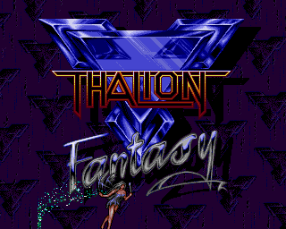
  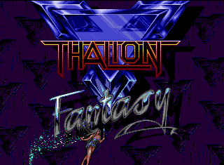

**The intro: the meteor falls on Twinlake**

  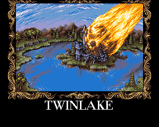
  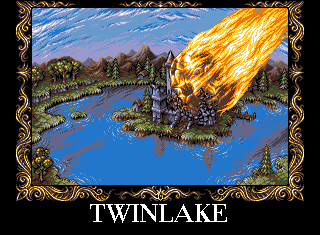

**Grandfather's house (2D)**

  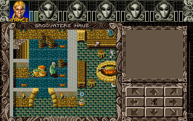
  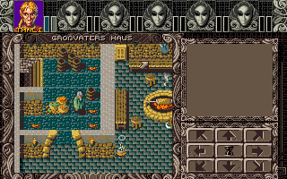

**The Lyramion islands (2D)**

  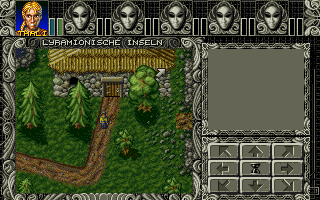
  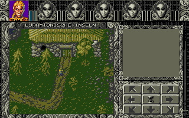

**Grandfather's cellar (3D)**

  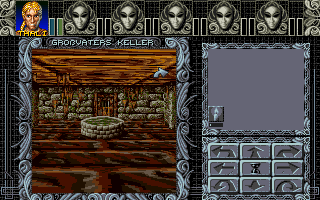
  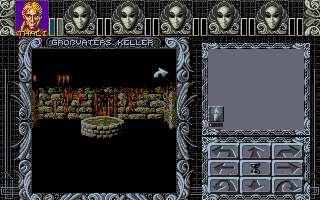

**The city of Spannenberg (3D)**

  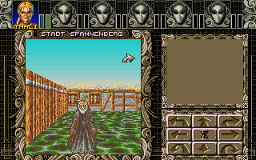
  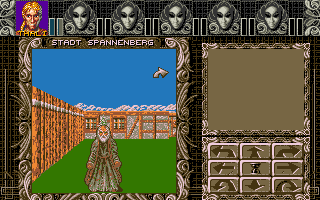

**The house of the trainers (2D)**

  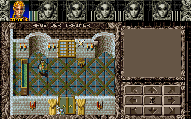
  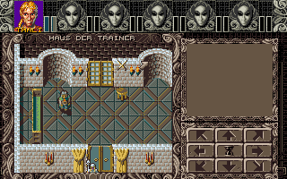

Back to the [README](README.md).
