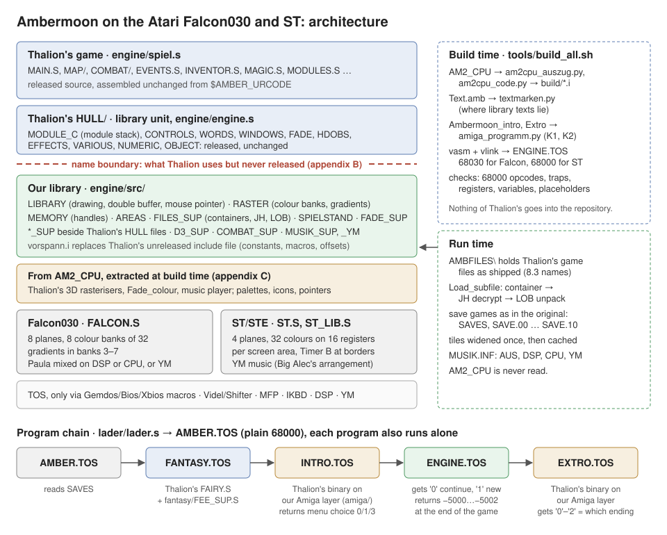

# 2. Architecture



## Two goals, of equal rank

1. **Take Thalion's source, do not rebuild it.** Thalion's files are
   assembled unchanged. We write only what was never released: the
   library underneath. Copying Thalion's routines or data into our files
   does not count as taking them over either.
2. **Read the original game files at run time.** Containers, the JH
   encryption and the LOB compression are undone while the game runs; no
   file is converted in advance.

Both goals have the same reason: the game logic, layout and graphics stay
Thalion's in every detail, so we cannot add our own bugs to them, and the
game feels like the Amiga original.

**One exception:** the fantasy intro, the intro and the extro play without
interaction. There our own routines may replace Thalion's at bottlenecks
(zooms, the logo build-up), with graphics in Atari format and
precomputation, so that they run smoothly. Sequence, texts, colours and
timing stay Thalion's. The game itself has no such exception.

**`AM2_CPU` only at build time** (user, 2026-09-27/28). What the library
needs from Thalion's compiled library (palettes, icons, pointers, tables,
the music player, and Thalion's pure memory routines such as the 3D
rasterisers and `Fade_colour`) the build extracts into
`build/am2cpu_daten.i` and `build/am2cpu_code.i`. This does not count as
a copy under goal 1: the repository holds only the tools and the places
they read, never the bytes. `AM2_CPU` is never read at run time, and new
library data goes the same way, never into the repository. Why this was
decided, and how to go back if it was wrong: `docs/02-3D-Renderpfad.md`
A7. Appendix C lists every piece.

Where we leave the two goals is decided by the user only and listed in
`docs/17-deviations.md`; the code marks each place with `DEVIATION (goal
N)`.

## Where the boundary lies

Thalion came from the Atari and planned ports. The released code is
hardware-independent: it reaches the machine only through

- **names of the library**: `jsr Put_unmasked_block`, `Mouse_X`,
  `Load_subfile`;
- **equates**: `Screen_depth`, `Bytes_per_line`;
- **register contracts**: `d5` = planes of the source, `d4` = colour
  offset, `Work_screen` = where to draw.

The hardware shows only in the library itself, which Thalion assembled
separately and shipped as the Amiga executable `AM2_CPU`, never as
source. **So we rebuild exactly this library, and everything above it
runs unchanged.** In Thalion's released source only two of forty files
touch the machine directly: `FAIRY.S` (the fantasy intro, a program of
its own) and `HULL/VARIOUS.S`.

The consequences:

- Adaptations belong in the library layer (`engine/src/`) and in
  `tools/originalcode/vorspann.i`, never in Thalion's code and as little
  as possible in the build tools.
- Thalion's data stays in Thalion's format in memory: five planes, Amiga
  bitplane layout, Amiga colour words. The library converts while
  drawing. A graphic widened in advance would be a detour at the wrong
  place.
- For speed the library may convert and cache at run time (the tile
  cache, the ST's colour tables), as long as it stays in our layer and
  Thalion's code and data remain untouched.

## The layers

| Layer | Where | Who |
|---|---|---|
| Game | `engine/spiel.s` includes `MAIN.S`, `MAP/`, `COMBAT/`, `EVENTS.S`, `INVENTOR.S` … | Thalion, unchanged |
| Thalion's library part | `engine/engine.s` includes `HULL/MODULE_C.S`, `CONTROLS.S`, `WORDS.S`, `WINDOWS.S`, `FADE.S`, `HDOBS.S`, `EFFECTS.S`, `VARIOUS.S`, `NUMERIC.S`, `OBJECT.S` | Thalion, released, unchanged |
| **Name boundary** | some 400 names: appendix B | |
| Our library | `engine/src/`: drawing, double buffer, mouse, memory, files, colours | us |
| Pieces of `AM2_CPU` | `build/am2cpu_daten.i`, `build/am2cpu_code.i`: 3D rasterisers, `Fade_colour`, the music player, palettes, icons, pointers | Thalion's, extracted at build time (appendix C) |
| Hardware | `FALCON.S` or `ST.S`, `FALCON_LIB.S` or `ST_LIB.S`, the hardware parts of `RASTER.S`, `MUSIK_SUP.S`, the mouse and keyboard parts of `LIBRARY.S` and `VARIOUS_SUP.S` | us |
| TOS | only through the macros `Gemdos`, `Bios`, `Xbios` | |

Thalion's `HULL/` files belong to the library unit but are released
source. They run unchanged; our `*_SUP.S` files next to them supply what
they need from below (appendix A lists the pairs).

Placeholders for names we have not built yet stand in
`engine/src/HULL/AM2_CPU_STUBS.S`. Today there are none: the last one,
`Rune_flag`, is real since 2026-10-17 (`WORDS_SUP.S`, tested on the hardware 2026-10-23). The file
stays for the next one; `tools/platzhalter_karte.py` shows which call
paths lead to a placeholder.

## How the parts work together

The tables above say where things are. The traces below follow single
calls through every layer, so you can see which file hands what to which.
Thalion's names are in plain `code`; our routines are named with their
file.

### Who talks to whom

```
 Thalion's game (spiel.s)          MAP/, COMBAT/, EVENTS.S, INVENTOR.S, DISPLAY.S …
   │ jsr <library name>            ~400 names, appendix B; registers as in AM2_CPU
   ▼
 Thalion's HULL (engine.s)         MODULE_C.S  module stack, Update_display, Handle_input
   │                               FADE.S      Fade_in/out_* -> Set_fade
   │                               WINDOWS.S, HDOBS.S, CONTROLS.S, WORDS.S, EFFECTS.S …
   ▼
 our library (engine/src/)
   LIBRARY.S ── drawing ──────────► RASTER.S   which bank in which line, gradient slots
       │  │                         FADE_SUP.S  palettes into banks, fades
       │  └── tile cache, pointer, double buffer, VBL dispatcher
   MEMORY.S   handles ◄──────────── FILES_SUP.S  load, decrypt, unpack ── SPIELSTAND.S
   AREAS.S    PA / MA / pointer stacks          WORDS_SUP.S, INVENTOR_SUP.S (text, items)
   VARIOUS_SUP.S  keys, mouse events            D3_SUP.S, COMBAT_SUP.S (3D, zoom)
   MUSIK_SUP.S / MUSIK_YM.S ──────► musik/MISCHER.S (+ MUSIK_DSP.A56)
   │
   ▼
 hardware                          FALCON.S | ST.S + ST_LIB.S, RASTER.S (Timer B on the ST)
   │
   ▼
 TOS                               only Gemdos / Bios / Xbios (FALCON_OFF.S)

 from AM2_CPU at build time        build/am2cpu_daten.i  palettes, icons, pointers, texts
                                   build/am2cpu_code.i   3D rasterisers, Fade_colour, music player
```

Two directions run against the arrows. **We call Thalion** in four places
where the original library did: `Init_program` (from `Restart_game`),
`Update_display`/`Handle_input` (the main loop), `VblQ_handler` (from
`Bibliothek_vbl`) and `ScrQ_handler` (from `Switch_screens`). And **we
read Thalion's data** in place: module descriptors, raster lists,
palettes; the library keeps pointers, not copies (finding 192).

### Trace 1: one tile of the 2D map, from Thalion to the screen

```
Main_loop (MAIN.S)
 └ Thalion's Update_display           top module's DisUpd: C2_DisUpd (C2Map_Mod)
    └ Thalion's Display_2D_map        MAP/2D_MAP.S, ~200 tiles per frame
       └ Display_2D_underlay
          jsr Put_unmasked_icon       a0 = tile, d0/d1 = corner, d4 = 0, d5 = 5
          │                           LIBRARY.S: the contract is AM2_CPU's
          ├ Farbbank_spanne(d1)       which bank in this line, and up to where?
          │   Zeichenliste            Work_screen = Off_screen -> top module's list
          │   (Module_Sp, Raster_list_ptr; empty -> the module below)
          │   Platzbank               place of the R_palette -> bank 2/0/1 (finding 264)
          ├ Kachel_holen              cache: widened 5 -> 8 planes once,
          │                           valid only for identical source (finding 271)
          ├ copy 16 lines into Work_screen (8 planes, word-interleaved)
          └ nb_bloecke -> Bereich_nacharbeiten (RASTER.S)
                                      in gradient lines: bank + colour 25 -> slot
 └ Thalion's Handle_input
 └ Switch_screens (LIBRARY.S)
    Schirmwechsel                    Thalion's Draw_HDOBs, pointer into the back
                                     screen, swap, Anzeige_setzen (wait for VBL),
                                     pointer out, Thalion's Erase_HDOBs
    Thalion's ScrQ_handler
```

On the ST, the same call goes through `ST_LIB.S`, which `LIBRARY.S`
calls under the same neutral names: the colour number goes through the table of
the screen area instead of getting a bank (chapter 6).

### Trace 2: opening the inventory, from module to colour registers

```
Thalion's code: Push Module,Inv2_Mod          macro (vorspann.i): lea / jsr Push_Module
 └ Thalion's Push_Module (HULL/MODULE_C.S)   copies the descriptor onto the module
                                              stack (-1 = take the entry below);
                                              no DisInit, the module's own code does that
    Init_module                               Push_Mptr, Push_PA, Push_MA (AREAS.S),
                                              then the module's ModInit
       Thalion draws the screen               Put_*, Draw_box … (trace 1); the bank of
                                              every line now comes from Inv_RL
       Thalion's Fade_in_bottom (HULL/FADE.S)
        └ Set_fade (FADE_SUP.S)               d0 = kind, d1..d2 = lines, a0 = Inv_RL
           collect the places whose R_palette starts in d1..d2
           Platz_setzen / Bank_setzen         32 Amiga words -> Videl bank (VsetRGB)
           Bereiche_sammeln (RASTER.S)        R_range lines -> slots in banks 3-7
           fade in 15 steps, about a third of a second, or set at once
        My_vsync, Update_screen               show the back screen
```

A **local** module (a requester, an item view) runs its own small main
loop inside `Push_Module` (`Update_display`, `Handle_input`,
`Switch_screens`) until it is popped; a global one returns at once and the
outer loop in `MAIN.S` carries on.

The next module (inventory → item view) may have no raster list; then
`Zeichenliste` walks down the module stack, and the inventory's list
stays in force, as the copper list stayed on the Amiga.

### Trace 3: one game file

`jsr Load_subfile` with Thalion's file number and entry →
`FILES_SUP.S` picks the container and the 8.3 name, prefixes `AMBFILES\`,
reads the header, decrypts (JH) and unpacks (LOB) into memory from
`MEMORY.S` → Thalion gets a **handle**, and `Claim_pointer` turns it into
an address. Chapter 8 has the details.

### Trace 4: one frame of the VBL

`Raster_vbl` (`RASTER.S`, in the TOS VBL queue) → `Bibliothek_vbl`
(`LIBRARY.S`): `VBL_counter`, picture base, `Maus_vbl` (button state and
one mouse event for Thalion's `Read_Mev`), the pointer follows the mouse
in the shown screen, Thalion's `VblQ_handler`, `Musik_vbl`. Chapter 3
has the order and the reasons.

### Input

The mouse comes as IKBD packets into `Mouse_int` (`LIBRARY.S`); the VBL
turns them into Thalion's `Button_state` and mouse events, which
Thalion's `Handle_input` reads through `Read_Mev` (`VARIOUS_SUP.S`) and
matches against the module's `.Mev` list. Keys come through `Read_key`
(`VARIOUS_SUP.S`): Atari scan code → Thalion's Amiga raw key and
character (`Keymap` file) → the module's `.Kev` list. A module without
these lists takes no input (finding 187: a module descriptor left as a
zero placeholder in `*_STUBS.S` locked every key).

## Two targets

One source tree builds both. `build_all.sh` builds both, so a change for
the Falcon that breaks the ST shows at once; `build_falcon.sh` and
`build_st.sh` build one each. Both deliver into the shared `ATARI/`.

| | Falcon030 | ST/STE |
|---|---|---|
| Program | `AMBER.TOS` (one loader for both, cookie `_MCH`), `AMBFILES/ENGINE.TOS`, 68030 | `AMBER.TOS`, `AMBFILES/ENGINEST.TOS`, 68000, `-DZIEL_ST=1` (`tools/build_st.sh`) |
| Screen | 320×200, 8 planes, 256 colours | 320×200, 4 planes, 16 registers |
| Hardware file | `FALCON.S` | `ST.S`, same names (`Open_screen`, `Close_screen` …) |
| Colour when drawing | bank of the line + colour number | table per screen area: colour number → register (`ST_LIB.S`) |
| Palettes per screen area | colour banks, no interrupt | Timer B reloads the 16 registers at each border |
| Gradients (`R_range`) | one slot per line in banks 3–7 | flat, by decision |
| 3D floors and ceilings | yes (Thalion's 68020 code, chosen by `_CPU`) | no |
| Music | Paula emulated, mixed on the DSP or the CPU; or YM | YM (Big Alec's arrangement) |
| Machine detection | cookies `_CPU`, `_SND` | cookies `_MCH`, `_VDO`; STE colours and fine scrolling when present |

Where the machines differ inside a shared routine, `LIBRARY.S` calls the
machine part under a neutral name that `FALCON_LIB.S` and `ST_LIB.S` both
define, for example `Zeilenfarbe` (the bank on the Falcon, the table on
the ST) or `Quelle_aufweiten`; everything else is shared (library split,
chapter 5). Every build also assembles a 68000 cross-check
of the Falcon library, so no 68020 instruction slips into shared code.
