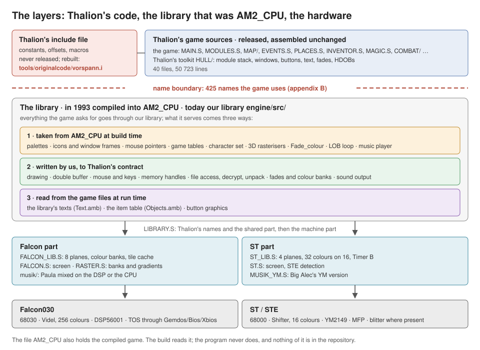

# 0. The big picture

If you read one chapter, read this one. It answers four questions: what
Thalion released, what Thalion's code does, where the hardware begins,
and how our library takes the place of the part Thalion never released.

## What Thalion released, and what not

Ambermoon was written in 1992–1993. Almost every file carries the name
of Jurie Horneman; `MAP/3D_MAP.S` was written by Michael Bittner and
adapted by Horneman. Horneman later published a snapshot of the source
with development documents
([jhorneman/ambermoon](https://github.com/jhorneman/ambermoon)). It is
**40 assembler files, 50 723 lines**, for the Devpac-style assemblers of
the time. It is probably not complete and does not match the shipped
game in every detail. Our reference is the shipped game: the German
version 1.20, its game files and its `AM2_CPU`.

What the release does **not** contain:

- **the library underneath**: drawing, screen, mouse, memory, files,
  music, the 3D rasterisers. Thalion assembled it separately;
- **the include file** that all of Thalion's files use: constants,
  structure offsets, macros;
- some **data** the library brought along: palettes, icons, mouse
  pointers, tables.

Seen as layers, as in the picture above, that missing library is
**`AM2_CPU`**: everything between Thalion's game and the hardware.
Icons, palettes, mouse pointers, the music player, file access, drawing,
memory: the game reaches all of it through the library's names.

As a file, `AM2_CPU` is a little more. It is the Amiga executable that
ships with the game, and it holds the whole program: Thalion's game,
compiled, and the library, in 14 hunks (the Amiga's segments):

| Hunk | Kind | Size | What we know is in it |
|---|---|---:|---|
| 0 | code | 183 KB | the game (`M3_DisUpd` at `$101FC`, for instance) and the library (`Copy_screen` at `$21456`, the music player at `$2AA0E` …) |
| 3 | data | 15 KB | graphics: window frames, status bar, icons, buttons; the music player's tables |
| 4 | data | 33 KB | palettes, mouse pointers, game tables, the pointer lists of the library's texts |
| 6 | data | 0.3 KB | the message table, `Blitter_or_CPU` |
| 8 | code | 9 KB | the start routine |
| 11 | code | 14 KB | the 3D drawing switch between blitter and CPU, an edge-list helper |
| 13 | data | 0.9 KB | the character set and the rune table |
| 1, 2, 5, 7, 9, 10 | BSS | 212 KB | variables; hunk 9 holds the library's own |
| 12 | code | 1.7 KB | not needed so far |

The game part of the file we have as source and assemble ourselves. We
read the file for the library part: its data, and its machine code,
which `tools/am2cpu_lesen.py` disassembles when a contract is not clear
from Thalion's call sites. Only the build reads `AM2_CPU`; the program
never does.

## What Thalion's code does

The files fall into six groups. Line counts are Thalion's.

| Group | Files | Lines | What it does |
|---|---|---:|---|
| **Frame** | `MAIN.S`, `MODULES.S`, `GAME_OFF.S`, `DIAGNOST.S` | 6 436 | `Init_program`, the game's main loop and its data; `MODULES.S` describes every screen as a module; `GAME_OFF.S` the structures of the game; `DIAGNOST.S` the "out of memory" handling |
| **World** | `MAP/` (map handling, 2D cities, 2D wilderness, 3D), `EVENTS.S`, `PLACES.S`, `PERSONS.S`, `DIALOGUE.S`, `TIME.S`, `WORD_SEL.S` | 15 473 | moving through the world, map events (chains of conditions and actions), shops, inns, trainers, people walking about, conversations, the clock, choosing a word to say |
| **Party** | `INVENTOR.S`, `CHARACTE.S`, `MAGIC.S`, `ACTIONS.S`, `DISPLAY.S` | 10 059 | inventory, character editor, spells outside combat, the action buttons, the portraits and status display |
| **Combat** | `COMBAT/` (seven files) | 10 295 | the battlefield, monster logic, combat magic in both directions, the combat objects on screen, the tactic window, the screen after combat |
| **Overview** | `AUTOMAPP.S`, `MINIMAP.S` | 1 829 | the automap, the minimap |
| **Thalion's library part** | `HULL/` (ten files) | 5 773 | the released part of the library: a user-interface toolkit (below) |

And one file apart: `FAIRY.S` (858 lines), the fantasy intro, a program
of its own.

### The module stack

Everything on screen is a **module**: the 2D map, the 3D map, the
inventory, combat, a dialogue, a requester. `MODULES.S` holds one
descriptor per module: its routines (set up, draw, update, close), its
lists of mouse areas and keys, and its **raster list** (which palette
applies from which line, chapter 2). `HULL/MODULE_C.S` keeps them on a
stack. Opening the inventory pushes a module on top of the map; closing
it pops it, and the map is back. The main loop draws the top module and
hands it the input.

### `HULL/`: Thalion's toolkit

The ten `HULL/` files are released and belong to the library, but they
are written on top of the unreleased part, not beside it:

| File | Lines | What it does |
|---|---:|---|
| `MODULE_C.S` | 598 | the module stack: push, pop, the main loop's two calls `Update_display` and `Handle_input` |
| `CONTROLS.S` | 1 787 | buttons and control icons, scroll bars |
| `WORDS.S` | 1 028 | text: display, scroll, wrap, wait for the player |
| `WINDOWS.S` | 240 | windows: open, save the background, close |
| `FADE.S` | 224 | fades: "fade the top in", "fade all out" … |
| `HDOBS.S` | 231 | hand-drawn objects, graphics that float over the screen and are redrawn every frame |
| `EFFECTS.S` | 542 | special effects: HDOBs that drop, shake or move, bitmaps that explode into pixels |
| `VARIOUS.S` | 647 | random numbers, multiplication, `Set_music` |
| `NUMERIC.S` | 341 | numbers to text |
| `OBJECT.S` | 135 | the object tree: which part of the screen a click hit |

## Where the hardware begins

Thalion came from the Atari and planned ports. The game code is written
so that it reaches the machine **only through the library**, in three
ways:

- **names**: `jsr Put_unmasked_block` to draw, `Mouse_X` to read the
  mouse, `jsr Load_subfile` to load. What the name does is the library's
  business.
- **equates**: `Screen_depth` (5), `Bytes_per_line`. Thalion's code
  computes with them instead of with numbers.
- **register contracts**: `d5` = planes of the source, `d4` = colour
  offset, `Work_screen` = where to draw. The game says *what* to draw;
  the library knows *how* the screen is built.

Of the 40 files only two touch the hardware directly:

- `FAIRY.S`, the fantasy intro: sprites, copper, blitter, in another
  style than the rest. We rebind its ten hardware operands after linking
  (`tools/fairy_umbiegen.py`).
- `HULL/VARIOUS.S`, in two lines: `move.w #$000f,Custom+dmacon` turns
  the four sound channels off before the music is removed. In our build
  `Custom` points to the shadow of the sound chip (`MUSIK_SUP.S`), so the
  line does its job without touching hardware.

Thalion even built switches for different machines into the code:
`Blitter_or_CPU` chooses between blitter and processor versions of the
3D drawing, and a 68020 path draws textured floors and ceilings. We set
the switch to "CPU"; the Falcon takes the 68020 path.

**That is the core idea of this port: we rebuild the library, and
everything above it runs unchanged.**

## What the game asks of the library

Every name that Thalion's game uses without defining it is part of the
interface. There are **425**:

| Kind | Number | Examples |
|---|---:|---|
| routines | 72 | `Put_unmasked_block`, `Draw_box`, `Switch_screens`, `Load_subfile`, `Claim_pointer`, `Read_key`, `Set_fade` |
| data and variables | 222 | `Main_pal`, `Default_Mptr`, `Status_icons`, texts like `Gold_txt`; variables `Mouse_X`, `Button_state`, `VBL_counter`, `Work_screen` |
| constants and structure offsets | 119 | `Screen_depth`, `Middle_Y`, `Pal_size`, the offsets of the module descriptor |
| macros | 12 | `Get`, `Free` (memory), `Push`, `Pop` (stacks), `R_palette`, `R_range`, `R_end` (raster lists) |

Every one of them is listed in [appendix B of the developer
documentation](../developer/appendix-b-symbols.md), with the number of
Thalion's uses and where we define it.

A name is more than a name: it is a **contract**. Which registers go in,
which come out, which survive; whether it is data or code; how long a
structure is. The linker checks only that a name exists; whether the
contract holds shows when the game runs. That is why every routine of
our library is written from Thalion's call sites, and where those leave
it open, from the machine code in `AM2_CPU`
([developer chapter 4](../developer/04-interface.md)).

## Four ways to fill the gap

The picture at the top of this chapter shows it. The game reaches
everything through our library, and what the library serves comes three
ways; the include file is the fourth. Below the library, a shared part
(`LIBRARY.S`, with Thalion's names) hands over to a Falcon part and an
ST part.

**1. Taken from `AM2_CPU` at build time.** What does not touch the
hardware we do not rewrite: Thalion's data, and code that only computes
in memory. The build cuts it out of `AM2_CPU` into `build/am2cpu_daten.i`
and `build/am2cpu_code.i`. Nothing of it is in the repository, and the
program never reads `AM2_CPU` while it runs.

- data, 96 names: the palettes `Main_pal`, `Tactic_pal`, `Automap_pal`,
  the sky gradients, 26 mouse pointers, window frames and icons, game
  tables like `Spell_data` and `Destruction_table`, the character set;
- code (19 names of the interface, routines and their variables): the 3D rasterisers (`put_dpoly`, `Draw_floor`,
  `Draw_ceiling`), the light level `Fade_colour`, the inner loop of the
  decompressor `Lob_core`, the front parts of the combat zoom, and the
  Sonic Arranger music player, whose writes to the sound chip go to our
  shadow registers.

The tool refuses any piece that touches hardware, jumps out of itself or
carries an address it cannot name ([appendix
C](../developer/appendix-c-am2cpu.md)).

**2. Written by us, to the contract.** Everything that touches screen,
blitter, interrupts or the operating system, we write for the Falcon and
the ST:

| Family | Thalion's names | Our file (`engine/src/`) |
|---|---|---|
| drawing | `Put_unmasked_block`, `Put_masked_block`, `Put_masked_icon`, `Draw_box`, `Plot_pixel`, `Get_block`, `Get_pixel` | `HULL/LIBRARY.S`, with the machine parts `FALCON_LIB.S` and `ST_LIB.S` |
| screens | `Update_screen`, `Switch_screens`, `Copy_screen`, `Work_screen`, `Off_screen` | `HULL/LIBRARY.S`; the hardware in `FALCON.S` / `ST.S` |
| colours | `Set_fade`, `Wait_4_fade`, `My_vsync` | `HULL/FADE_SUP.S`, `HULL/RASTER.S` |
| areas | `Push_MA`, `Pop_MA`, `Push_Mptr`, `Push_CA` … (mouse areas, pointers, clip areas, print areas) | `HULL/AREAS.S`, `HULL/EFFECTS_SUP.S` |
| input | `Mouse_X`, `Button_state`, `Read_Mev`, `Read_key`, `Mouse_on` | `HULL/LIBRARY.S`, `HULL/VARIOUS_SUP.S` |
| memory | `Allocate_memory`, `Claim_pointer`, `Free_pointer`, `Free_memory`, macros `Get`, `Free` | `HULL/MEMORY.S` |
| files | `Load_subfile`, `Load_file`, `Save_subfile`, `Decompress` | `HULL/FILES_SUP.S`, `HULL/SPIELSTAND.S` |
| music | `Music_routine` | `HULL/MUSIK_SUP.S`, `HULL/MUSIK_YM.S`, `musik/` |
| 3D, combat | `Show_MOVEP_screen`, `Clear_1plane_block`, the blitter part of the zoom | `HULL/D3_SUP.S`, `HULL/COMBAT_SUP.S` |
| start and end | `Restart_game`, `Exit_program`, `Return_value` | `MAIN.S` |
| diagnostics | `Init_diagnostic_screen`, `DI_Print` … | `HULL/DIAGNOSE_SUP.S` |

Where a routine has to behave differently on the two machines,
`LIBRARY.S` keeps Thalion's name and the shared part, and calls a
machine part under a neutral name that `FALCON_LIB.S` and `ST_LIB.S`
both define ([developer chapter 5](../developer/05-our-layer.md)).

**3. Read from the game files at run time.** Some of what the library
held is also in the game files, and goal 2 of the project says to read
those as they are: the library's 85 texts (messages, names, templates)
come from `Text.amb`, the item table from `Objects.amb`, the button
graphics from their own file. The build only computes where in
`Text.amb` each text lies (`tools/textmarken.py`).

**4. The include file, rebuilt.** The 119 constants and 12 macros are in
`tools/originalcode/vorspann.i`. A constant there means what Thalion
meant, not what the Atari has: `Screen_depth` stays 5, although our
Falcon screen has 8 planes, because Thalion's code uses it for the depth
of its data (finding 191).

## And the other way round

The library does not only answer. In four places it calls Thalion,
because the original library did and Thalion's game never does it
itself:

| We call | From | When |
|---|---|---|
| `Init_program` | `Restart_game` (`MAIN.S`) | at start, and after loading a save game |
| `Update_display`, `Handle_input` | `Main_loop` (`MAIN.S`) | every frame: the top module draws and takes the input |
| `VblQ_handler` | `Bibliothek_vbl` (`LIBRARY.S`) | in every vertical blank: the modules' timers |
| `ScrQ_handler` | `Switch_screens` (`LIBRARY.S`) | at every screen swap |

The program entry itself is ours too: `start` in `engine/src/MAIN.S`
sets up screen, mouse, music and memory, then enters `Restart_game`.
[Developer chapter 3](../developer/03-entry-points.md) follows the whole
path.

## The rest of this guide

The following chapters take the hard problems of the second way one at
a time: [five planes on a machine that has eight](01-five-planes.md),
[the copper that becomes colour banks](02-colour-banks.md),
[files unpacked while playing](03-files-at-run-time.md), and, planned,
the music and the ST's 16 colours.
